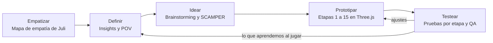
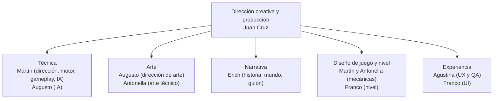
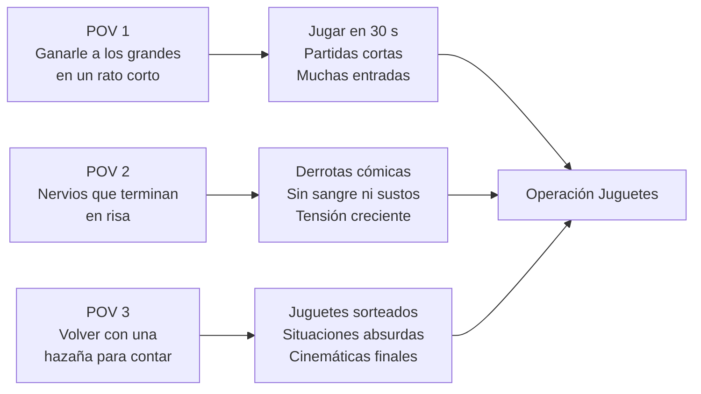
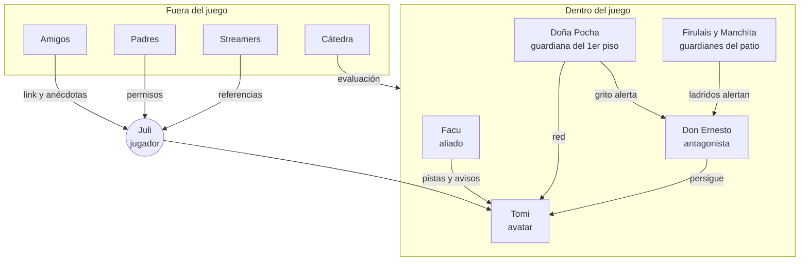
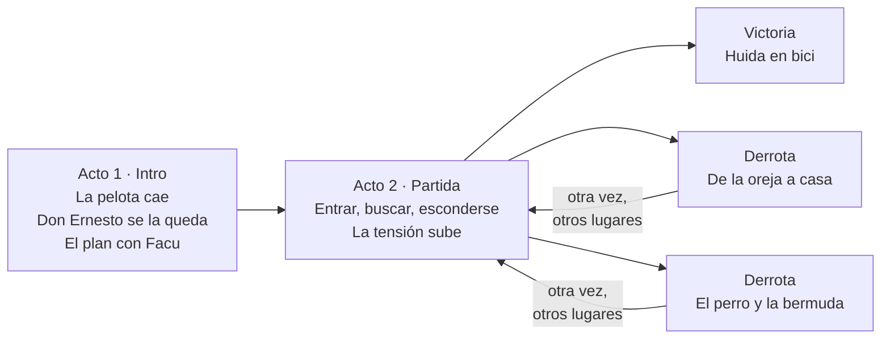
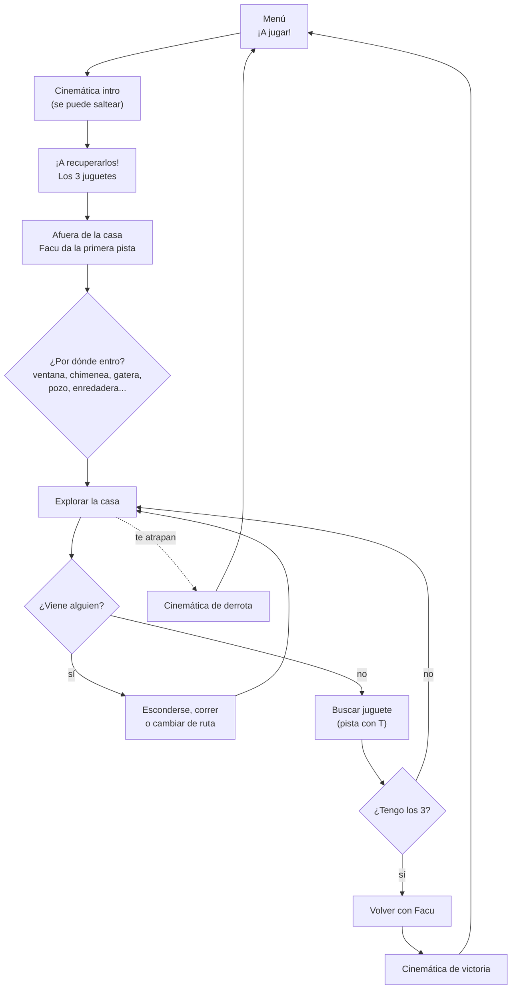
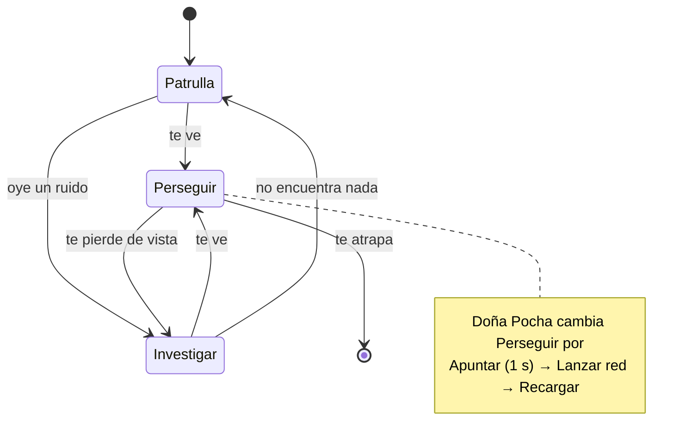
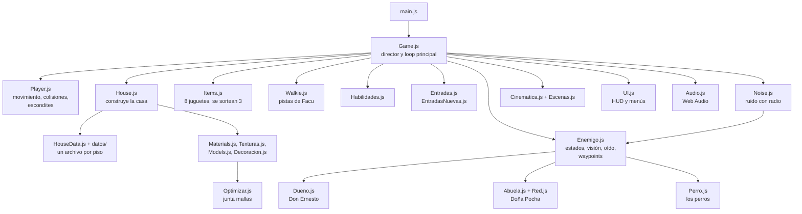
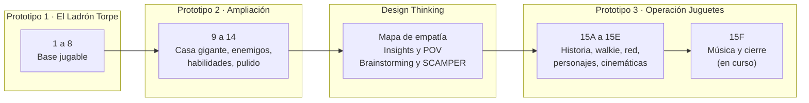

# Operación Juguetes — Solution Design Document

**Cátedra CDEV · Documento de sistematización del proceso creativo**

Equipo: Juan Cruz García Amadey, Martín Biondo Nardi, Augusto Serafini, Agustina Ardiles, Antonella Altamirano,
Erich Schreiner y Franco Leonel Martínez Baigorria.

> Los diagramas están escritos en Mermaid (se ven en GitHub y en VS Code). Donde dice **[Imagen: ...]** va una
> captura, un boceto o un tablero que se agrega en la versión compartida.

[Imagen: portada del juego — `portada/portada.png`]

---

## Índice

1. [Introducción](#1-introducción)
2. [Organización del equipo de diseño](#2-organización-del-equipo-de-diseño)
3. [Aspectos generales del diseño](#3-aspectos-generales-del-diseño)
4. [Análisis de usuarios y actores](#4-análisis-de-usuarios-y-actores)
5. [Narrativa inmersiva y perspectiva del usuario](#5-narrativa-inmersiva-y-perspectiva-del-usuario)
6. [Diseño multisensorial e interacción](#6-diseño-multisensorial-e-interacción)
7. [Arquitectura técnica](#7-arquitectura-técnica)
8. [Proceso de prototipado](#8-proceso-de-prototipado)
9. [Conclusión](#9-conclusión)
10. [Referencias](#10-referencias)
11. [Bibliografía](#11-bibliografía)
12. [Anexos](#12-anexos)

---

## 1. Introducción

*Operación Juguetes* es un juego 3D de sigilo y humor en primera persona que se juega en el navegador. El
jugador es Tomi, un nene del barrio que se mete en la casona de sus vecinos, Don Ernesto y Doña Pocha, para
recuperar tres juguetes que le quitaron cuando cayeron en su jardín. Afuera lo espera su amigo Facu, que le
pasa pistas por walkie-talkie y tiene las bicis listas para escapar.

Este documento sistematiza cómo llegamos hasta acá. El proyecto empezó como *El Ladrón Torpe*, un prototipo
técnico de sigilo en una casa, y se transformó cuando aplicamos Design Thinking: el mapa de empatía, los
insights y los puntos de vista nos mostraron que nuestro jugador no quería robar ni asustarse, sino ganarle
una a los grandes y volver con una anécdota para contar. A lo largo del SDD mostramos cómo esa conclusión se
traduce en decisiones técnicas, estéticas, narrativas y de experiencia.

---

## 2. Organización del equipo de diseño

Somos siete integrantes y cada uno cubre uno o más roles. Las decisiones de visión se toman en conjunto, pero
cada área tiene un responsable que cuida su coherencia y que valida los cambios antes de cerrar una etapa.

**Juan Cruz García Amadey** es *Creative Director* y *Producer*. Sostiene la visión general del entorno y cuida
que estética, narrativa y experiencia cuenten la misma historia. Como productor planifica las etapas, coordina
los roles y hace el seguimiento de las tareas y las entregas.

**Martín Biondo Nardi** es *Technical Director*, *Game Designer*, *Engine Programmer*, *Gameplay Programmer* y
*AI Programmer*. Eligió el stack (Three.js sobre Godot, para que el juego corra en el navegador), definió la
arquitectura y programó el loop principal, las colisiones, el render, el movimiento, el sigilo, la recolección
de juguetes y la base de la inteligencia de los enemigos.

**Augusto Serafini** es *Art Director* y *AI Programmer*. Define la identidad visual, la paleta y las
referencias del moodboard, y cuida la coherencia de los modelos 3D. En la parte de IA trabaja en la navegación
de los enemigos: patrullas, cono de visión y persecución.

**Agustina Ardiles** es *UX Designer* y *QA Tester*. Diseña los flujos de interacción y la navegación de menús
para que el juego se entienda sin tutorial, y diseña y ejecuta las pruebas que validan cada etapa antes de una
entrega.

**Antonella Altamirano** es *Game Designer* y *Technical Artist*. Co-diseña el balance de las mecánicas y la
curva de dificultad, y hace de puente entre arte y programación: materiales toon, iluminación, bordes de dibujo
animado y efectos visuales.

**Erich Schreiner** es *Narrative Director*, *World Builder* y *Writer*. Armó la estructura de la historia, el
trasfondo del barrio y de los vecinos, y escribe los diálogos, las frases de Facu por el walkie, los textos de
interfaz y el guion del tráiler.

**Franco Leonel Martínez Baigorria** es *Level Designer* y *UI Programmer*. Diseña la casa, la ubicación de
obstáculos, escondites y entradas y el ritmo del recorrido, y programa el HUD, los menús y la retroalimentación
visual al jugador.

---

## 3. Aspectos generales del diseño

### 3.1 Reto de diseño

¿Cómo podríamos diseñar un entorno virtual que, en un rato corto y sin instalar nada, le haga sentir a un
jugador joven la tensión de estar a punto de ser descubierto, el alivio de reírse un segundo después y el
orgullo de haberle ganado una a los grandes?

### 3.2 Problema, necesidad o motivación (emociones)

Nuestro jugador tiene poco tiempo libre y siente que su día lo deciden los adultos. Busca despejarse, pero los
juegos que encuentra lo asustan de verdad, le piden demasiada dedicación o no corren en su compu. La necesidad
de fondo no es "jugar más", sino recuperar un poco de control y volver con algo para contar.

Las emociones que queremos provocar siguen una curva: la bronca inicial cuando Don Ernesto se queda con la
pelota, los nervios al cruzar un pasillo con pasos acercándose, la risa cuando lo atrapan de una oreja o un
perro le arranca la bermuda, y la satisfacción de escapar en bici con los tres juguetes. La tensión siempre
termina en humor, nunca en angustia.

### 3.3 Público objetivo

El usuario es *Juli*, un chico o chica de 13 a 25 años que juega en una compu o notebook de gama media en sus
ratos libres y no se considera *gamer*. Los clientes son la cátedra, que evalúa el proceso y el prototipo, y,
de forma indirecta, el grupo de amigos de Juli, que es quien recibe el link y la anécdota.

### 3.4 Características generales

Es un juego de sigilo cómico en primera persona, para una persona, que se juega en el navegador con teclado y
mouse. Una partida dura entre cinco y quince minutos. La casa tiene sótano, tres pisos, ático, patio con perros
y más de diez formas de entrar. En cada partida se sortean tres juguetes entre ocho y sus ubicaciones, así que
nunca hay dos partidas iguales. El estilo es de dibujo animado, con materiales toon y bordes negros.

[Imagen: captura general de la casa desde la vereda]

### 3.5 Objetivos alineados con la estrategia

Los objetivos salen directamente de los tres puntos de vista de la fase Definir. Para el POV de la revancha en
un rato corto, el objetivo es que Juli juegue a los treinta segundos de abrir el link, sin tutoriales, y que
pueda ganar una partida en menos de quince minutos. Para el POV de los nervios que terminan en risa, el objetivo
es que toda derrota sea graciosa y que ningún elemento del juego dé miedo real. Para el POV de la hazaña para
contar, el objetivo es que cada partida sea distinta y que deje situaciones que den ganas de compartir.

A esto se suman dos objetivos técnicos que vienen del mapa de empatía: que el juego corra fluido en una notebook
de gama media y que se pueda compartir con un link, sin instalación ni cuenta.

---

## 4. Análisis de usuarios y actores

### 4.1 Usuarios primarios

El usuario primario es Juli. Juega en sesiones cortas, no lee instrucciones y prueba todo para ver qué pasa,
así que el juego se explica solo: los controles están en el menú, las interacciones se anuncian con un cartel
al acercarse y Facu le cuenta por el walkie qué tiene que hacer. Dice "una más" cuando siente que el próximo
intento es distinto y que está cerca de lograrlo, por eso los juguetes cambian de lugar y la derrota se
reinicia rápido. Comparte clips y anécdotas, por eso las derrotas son escenas pensadas para contarse.

El análisis completo está en el [Mapa de empatía](MAPA_EMPATIA.md) y en [Insights y POV](INSIGHTS_POV.md).

### 4.2 Actores del entorno

Dentro del juego, los actores son los personajes que dan forma a la experiencia. Don Ernesto es el antagonista
principal: recorre toda la casa, escucha, revisa escondites, traba puertas y se enoja cada vez más. Doña Pocha
cuida el primer piso desde su mecedora y dispara un lanzarredes que te deja enredado. Firulais y Manchita, los
perros del patio, ven poco pero oyen todo. Facu es el aliado: no entra a la casa, pero guía, avisa y espera
con las bicis.

Fuera del juego también hay actores que influyen en cómo se vive. Los amigos de Juli recomiendan, comparten y
compiten. Los padres deciden qué puede jugar y cuánto tiempo, y por eso evitamos la violencia y el terror. Los
streamers marcan qué es divertido mirar. La cátedra evalúa el proceso y el prototipo.

---

## 5. Narrativa inmersiva y perspectiva del usuario

### 5.1 Narrativa digital (storytelling)

La historia es una revancha de barrio. Cada vez que un juguete cae en el jardín de los vecinos, Don Ernesto
sale en bata y se lo queda: "¡Lo que cae en mi jardín es mío!". Una tarde Tomi se cansa y decide entrar a
recuperar tres. Facu, que espió con binoculares dónde los guardaron, se queda afuera como sus ojos. La historia
completa está en [HISTORIA.md](HISTORIA.md).

La estructura es de tres actos. La cinemática de introducción plantea el conflicto, presenta a los vecinos y a
los perros y anuncia cuáles son los tres juguetes de esa partida. El desarrollo es la partida, donde la
historia la escribe el jugador con sus decisiones. El desenlace es una de tres cinemáticas: la huida en bici
mientras Don Ernesto sacude el puño, Tomi sacado de la oreja hasta su casa, o un perro que le arranca la
bermuda y lo deja corriendo en calzoncillos de corazones.

Elegimos este tono porque responde al insight de la revancha contra los grandes. El protagonista no roba, recupera
lo que es suyo, y los adultos son exagerados y cómicos, no amenazantes. Es la clase de historia que Juli
reconoce de su propio barrio.

### 5.2 Inmersión, agencia y transformación (Janet Murray)

Murray propone tres placeres estéticos del medio digital. Los usamos como guía para revisar si el diseño
cumple lo que promete.

**Inmersión.** Es la sensación de estar dentro de otro mundo. La logramos con la primera persona, con una casa
grande y creíble llena de detalles (empapelados, cuadros, telarañas, goteras, sábanas sobre los muebles), con
sonidos que se acercan cuando alguien camina cerca y con una luz que cambia de piso a piso, como el sótano
oscuro con lamparitas que parpadean. El walkie también es inmersivo: Facu habla desde dentro de la ficción, no
un cartel de tutorial.

**Agencia.** Es el poder de hacer cosas que tienen consecuencias visibles. El jugador elige por dónde entrar
entre más de diez opciones, cada una con su costo en ruido, distancia y riesgo; elige qué ruta tomar, cuándo
correr o agacharse, dónde esconderse y cuándo pedirle una pista a Facu, sabiendo que la radio hace ruido. Cada
decisión cambia lo que hacen los enemigos.

**Transformación.** Murray la entiende tanto como la variedad de una experiencia que se reconfigura como la
transformación de quien la vive. En lo primero, el sorteo de juguetes y ubicaciones hace que cada intento sea
otra partida. En lo segundo, Tomi pasa de ser el chico al que le quitan las cosas a ser el que se las arregla
solo, y eso es exactamente lo que Juli busca sentir.

### 5.3 Perspectiva del usuario (flujo y POV)

El jugador ve el mundo con los ojos de Tomi, a la altura de un nene. Los muebles parecen grandes, Don Ernesto
también, y agacharse para pasar por un conducto se siente natural. En las cinemáticas la cámara sale del cuerpo
y muestra la escena en tercera persona, con barras negras de cine, para que el jugador vea a Tomi y entienda
la historia desde afuera.

Para sostener el estado de flujo (Csikszentmihalyi) la dificultad crece sola: cada treinta segundos Don
Ernesto camina un poco más rápido y a veces traba puertas. Al principio el jugador explora tranquilo y al
final cada pasillo es una apuesta. Las pistas de Facu son cada vez más precisas, así que el desafío y la
ayuda suben juntos.

---

## 6. Diseño multisensorial e interacción

### 6.1 Estética visual

El estilo es de dibujo animado: materiales toon de tres tonos y bordes negros, colores saturados y personajes
exagerados. Es una decisión estética y técnica a la vez, porque se ve bien sin texturas pesadas y corre en una
notebook común. La referencia de tono es una película familiar de travesuras, no un juego de terror.

Los personajes están hechos con formas básicas y telas dibujadas con código. Don Ernesto es pelado, de bigotazo,
con bata a cuadros, pijama a rayas, pantuflas con pompón y palo de amasar, y se pone colorado mientras persigue.
Doña Pocha tiene ruleros, pañuelo con lunares, anteojos enormes, saquito tejido y pantuflas de conejito, y teje
en su mecedora con el lanzarredes al lado. Los muebles y las plantas son modelos de Kenney con licencia libre,
y la casa, las texturas, el cielo y el barrio los hicimos nosotros.

La casa cambia de clima en cada nivel. La planta baja es cálida y doméstica, los pisos de arriba se ponen más
raros, el sótano es oscuro y tiene un cuadro que te sigue con la mirada y el ático está lleno de polvo y trastos.
Así la ambientación acompaña la tensión sin cruzar al terror.

[Imagen: moodboard — paleta, materiales toon, referencias de películas de travesuras y juegos de sigilo cómicos]

[Imagen: hoja de personajes — Tomi, Facu, Don Ernesto y Doña Pocha]

[Imagen: capturas de cada nivel de la casa — planta baja, primer piso, sótano y ático]

### 6.2 Inmersión y dispositivos

Elegimos PC con navegador, teclado y mouse. Pensamos en realidad virtual y en consolas, pero el mapa de empatía
fue claro: Juli juega en la compu de su casa, no tiene equipos caros y quiere probar algo con un link que le
pasa un amigo. Por eso la inmersión no viene del dispositivo sino de la perspectiva en primera persona, del
sonido espacial y de la ficción. El mouse queda atrapado en la ventana (Pointer Lock) para que mirar se sienta
como mover la cabeza.

### 6.3 Tipos y diseño de dispositivos de interacción

El control sigue las convenciones de los juegos de PC para que Juli no tenga que aprender nada: WASD para
moverse, el mouse para mirar, Shift para correr, Espacio para saltar, C para agacharse y una sola tecla, E,
para todo lo que se hace con las manos (abrir puertas, esconderse, agarrar juguetes y habilidades). La T llama
a Facu por el walkie, la M silencia el sonido, la B activa los bordes de dibujo animado y Esc pausa.

La interfaz busca ser lo más parte del mundo posible. El walkie-talkie aparece abajo a la izquierda con la cara
de Facu y el texto letra por letra. Cuando Tomi se esconde, la pantalla se tapa con la vista desde adentro
(las rendijas del placard, la cortina de la bañera, las hojas del arbusto). El HUD solo muestra lo que un nene
sabría: la lista de juguetes con lo que Facu le dijo de cada uno, un ruidómetro con cuánto ruido está haciendo
y el tiempo que le queda a una habilidad.

[Imagen: HUD en partida — lista de juguetes, ruidómetro y panel del walkie]

[Imagen: vista desde un escondite]

### 6.4 Diseño sonoro

Todo el sonido se genera en el momento con la Web Audio API, sin archivos de audio: pasos, puertas, ladridos,
el "¡FUAP!" de la red, el grito de "¡ERNESTOOO!", el timbre de la bici y las vocecitas de cada personaje cuando
habla. Esto mantiene el juego liviano y le da una identidad sonora propia, cercana a un dibujo animado.

El sonido es también una mecánica. Correr, romper una ventana o pedir una pista hacen ruido, y cada ruido tiene
un radio: los enemigos que lo oyen van a investigar. Los perros oyen al doble de distancia y Doña Pocha a la
mitad. El jugador aprende a escuchar los pasos de Don Ernesto para saber si viene.

La música cambia según la situación: un tema de puntillas mientras Tomi se mueve en sigilo y uno rápido cuando
lo persiguen. En la etapa que estamos cerrando se suman temas nuevos con bajo, melodía y percusión, transiciones
suaves y pasos que suenan distinto según el piso (madera, cerámica, pasto, alfombra o la chapa de los
conductos).

### 6.5 Diseño narrativo del entorno

La casa cuenta la historia sin palabras. Es la casa de dos viejos que acumulan: cuartos llenos, cajas en el
ático, sábanas sobre muebles que nadie usa, un cuarto de muñecas que da un poco de cosa y los juguetes de los
chicos del barrio guardados en los lugares más inesperados. El jardín con la cerca alta, el cartel y el patio de
los perros dicen que estos vecinos no quieren a nadie cerca.

El espacio también narra la relación entre los personajes. Doña Pocha tiene su territorio en el primer piso y
los perros el suyo en el patio; Don Ernesto es el único que va a todos lados. Los pasadizos secretos, los
conductos y el túnel desde el pozo hacen sentir que Tomi conoce trucos que los grandes no.

[Imagen: plano de la casa por niveles, con entradas, escondites y territorios de cada enemigo]

### 6.6 Interacción (agencia)

Las interacciones están pensadas como decisiones con precio. Entrar rompiendo una ventana es rápido pero
ruidoso; buscar la llave en las macetas es silencioso pero lleva tiempo; bajar por el pozo al túnel secreto es
seguro pero largo. Esconderse en el tacho de basura funciona, aunque después los perros te huelen de lejos.
Pedirle una pista a Facu ayuda, pero hay que esperar veinte segundos entre una y otra y la radio hace ruido.

Las habilidades amplían esas decisiones por unos segundos: la zanahoria deja ver uno de los juguetes a través de
las paredes, las botas de lana silencian los pasos y la bebida energética hace correr más rápido. Los enemigos
reaccionan a todo lo que hace el jugador, así que cada partida termina siendo una historia propia.

---

## 7. Arquitectura técnica

El juego está hecho con Three.js para el 3D y Vite para el desarrollo y la compilación. Elegimos Three.js sobre
Godot porque el resultado es una página web: se comparte con un link y corre en cualquier navegador moderno
sin instalar nada, que es lo que el perfil de Juli pedía. No usamos librerías de física ni de navegación: las
colisiones, la gravedad, la visión y los caminos de los enemigos están programados por nosotros de forma
simple, para poder explicarlos y ajustarlos.

El código se organiza alrededor de `Game.js`, que hace de director: crea todo, conecta las partes y corre el
loop principal. La casa entera está descrita como datos, con un archivo por piso, y el código la construye a
partir de ellos. Los cuatro enemigos comparten un mismo esqueleto con máquina de estados, visión y oído, y cada
uno cambia solo lo que lo hace distinto.

Algunas decisiones técnicas responden directamente a la experiencia. Para que corra en una notebook común, todo
lo que no se mueve se junta en pocas mallas, una por material, y hay una sola luz principal que sigue al
jugador de piso en piso. Las escaleras son rampas invisibles, así no hace falta física de escalones. Los
enemigos ven con distancia, ángulo y un rayo que comprueba si hay paredes en el medio, y buscan caminos entre
puntos conectados. Si un modelo 3D no carga, queda la forma básica y el juego funciona igual.

El detalle de cada sistema está en el [README](../README.md) del proyecto.

---

## 8. Proceso de prototipado

### 8.1 Iteraciones

Trabajamos por etapas cortas. Cada una se diseña, se programa, se prueba y se muestra antes de pasar a la
siguiente, y termina con un commit en el repositorio. Las pruebas son simulaciones desde la consola del
navegador: recorridos de los enemigos, que todo sea alcanzable, que las puertas funcionen y partidas completas
sin errores. Al cerrar cada etapa se vuelven a correr las pruebas de las anteriores.

Las etapas 1 a 8 dieron un primer prototipo jugable, *El Ladrón Torpe*: una casa, un dueño que patrulla, ruido,
escondites, sonido, menús y gráficos. Las etapas 9 a 14 lo ampliaron con salto y agacharse, una casa de cinco
niveles, conductos, pasadizos, perros, una abuela, habilidades, animaciones, más entradas y más escondites.

La etapa 15 es el giro que vino del proceso creativo. Con el mapa de empatía y los POV vimos que un ladrón que
roba no conectaba con Juli, y rediseñamos la historia: Tomi, Facu, los juguetes, el walkie, el lanzarredes,
los nuevos diseños de personajes y las cinemáticas. La última parte, con música nueva, pasos según el piso y
las pruebas de cierre, está en curso.

### 8.2 Herramientas de creatividad aplicadas

**Brainstorming.** Lo usamos para generar en cantidad, sin juzgar, las formas de entrar a la casa, los
escondites y las habilidades. De listas largas elegimos las que tenían un precio claro para el jugador y las
que daban más risa: así quedaron la chimenea, la gatera, el pozo con túnel, el tacho de basura que deja olor o
la zanahoria que deja ver a través de las paredes.

**SCAMPER.** Lo aplicamos para transformar *El Ladrón Torpe* en *Operación Juguetes*. *Sustituimos* al ladrón
por un nene y la van negra por dos bicis. *Combinamos* el sigilo solitario con un amigo que ayuda por radio.
*Adaptamos* una experiencia real de barrio, la pelota que cae en la casa del vecino y no vuelve. *Modificamos*
la escopeta de la abuela por un lanzarredes que enreda en vez de lastimar. Le dimos *otro uso* a objetos
cotidianos, como el tacho de basura o la cortina de la bañera, que pasan a ser escondites. *Eliminamos* la
violencia y la idea de muerte: perder es que te lleven de una oreja. *Reordenamos* el sentido moral de la
historia: el que se mete en la casa ya no roba, recupera lo que es suyo.

[Imagen: fotos o tablero del brainstorming y de la matriz SCAMPER]

### 8.3 Tráiler

El tráiler funciona como publicidad del juego terminado. Dura alrededor de sesenta segundos, se graba con el
propio juego (las cinemáticas y partidas reales) y está pensado para compartirse en redes, que es donde Juli
descubre lo que juega. El guion final y la voz son responsabilidad del área narrativa.

**Toma 1 · 0:00–0:06.** Plano general del barrio a la tarde, cámara que baja despacio. Se oye una pelota que
pica. Texto en pantalla: "Todo barrio tiene una casa así...".

**Toma 2 · 0:06–0:12.** Tomi patea, la pelota vuela por arriba de la cerca y cae en el jardín. La puerta se abre
de golpe y sale Don Ernesto, colorado: "¡Lo que cae en mi jardín es MÍO!".

**Toma 3 · 0:12–0:18.** Tomi y Facu en la cerca, mirando la casa. Facu levanta el walkie. Tomi: "Hoy los
recupero". Corte a negro con el título *Operación Juguetes*.

**Toma 4 · 0:18–0:30.** Montaje rápido en primera persona, con la música de sigilo: Tomi rompe una ventana, baja
por la chimenea, se arrastra por un conducto, sube por la enredadera. Cada plano dura un segundo.

**Toma 5 · 0:30–0:38.** Tensión: Tomi escondido en el placard, por las rendijas se ve pasar a Don Ernesto. La
música se corta. Silencio. Don Ernesto se frena... y sigue de largo.

**Toma 6 · 0:38–0:46.** Entra la música de persecución. Doña Pocha deja de tejer, apunta: "¡FUAP!". La red
enreda a Tomi. "¡ERNESTOOO!". Los perros ladran en el patio.

**Toma 7 · 0:46–0:52.** Las derrotas como remate cómico: Tomi sacado de la oreja, un perro tironeando de la
bermuda, ¡RIIIP! Texto: "Cada vez, en otro lugar".

**Toma 8 · 0:52–1:00.** La victoria: Tomi y Facu se van en bici, ring ring, mientras Don Ernesto sacude el puño
en la tranquera. Cierre con el logo, la frase "Lo que cae en su jardín... es tuyo" y el texto "Gratis en tu
navegador".

[Imagen: storyboard del tráiler — una viñeta por toma]

[Link al tráiler: pendiente]

---

## 9. Conclusión

El cambio más importante del proyecto no fue técnico sino de enfoque. Teníamos un prototipo que funcionaba, pero
recién al ponernos en el lugar de Juli entendimos para quién era y qué tenía que hacerle sentir. Esa
comprensión ordenó todas las decisiones: el navegador en vez de un ejecutable, el humor en vez del miedo, el
lanzarredes en vez de la escopeta, el walkie en vez de un tutorial y los juguetes sorteados en vez de un
recorrido fijo.

Haber construido primero la base técnica nos permitió rediseñar la historia sin empezar de cero: como la casa,
los enemigos y los objetos estaban descritos como datos, cambiar de ladrón a nene fue cambiar datos, textos y
personajes, no reescribir el motor. A la vez, reconocemos que empezamos por la técnica y llegamos tarde al
usuario; en un próximo proyecto haríamos el mapa de empatía antes de la primera línea de código.

Nos quedan pendientes cerrar la música y las pruebas finales, probar el juego con jugadores reales del perfil
de Juli para validar los objetivos de duración y de humor, y medir el rendimiento en notebooks de gama baja.

---

## 10. Referencias

*Hello Neighbor* (tinyBuild, 2017). Juego de sigilo en el que el jugador se mete en la casa de un vecino; lo
tomamos como referencia de premisa y nos diferenciamos con un tono sin terror.

*Untitled Goose Game* (House House, 2019). Referencia de sigilo cómico, con travesuras y vecinos que reaccionan.

*Mi pobre angelito* (*Home Alone*, Chris Columbus, 1990). Referencia de tono: un chico que se las arregla solo
contra adultos torpes, en una casa grande.

Kenney, *Furniture Kit* y *Nature Kit*. Modelos 3D con licencia CC0. https://kenney.nl

Three.js, documentación oficial. https://threejs.org/docs

Vite, documentación oficial. https://vite.dev

MDN Web Docs, *Web Audio API*. https://developer.mozilla.org/es/docs/Web/API/Web_Audio_API

---

## 11. Bibliografía

Brown, T. (2009). *Change by Design: How Design Thinking Transforms Organizations and Inspires Innovation*.
HarperBusiness.

Csikszentmihalyi, M. (1990). *Flow: The Psychology of Optimal Experience*. Harper & Row.

Eberle, B. (1971). *SCAMPER: Games for Imagination Development*. D.O.K. Publishers.

Hasso Plattner Institute of Design at Stanford (d.school). *Bootcamp Bootleg*.

Maslow, A. H. (1943). A Theory of Human Motivation. *Psychological Review*, 50(4), 370–396.

Murray, J. H. (1999). *Hamlet en la holocubierta: el futuro de la narrativa en el ciberespacio*. Paidós.
(Original: *Hamlet on the Holodeck*, 1997.)

Osborn, A. F. (1953). *Applied Imagination*. Charles Scribner's Sons.

Schell, J. (2008). *The Art of Game Design: A Book of Lenses*. Morgan Kaufmann.

---

## 12. Anexos

El [Mapa de empatía](MAPA_EMPATIA.md) describe a Juli, el jugador al que apuntamos. [Insights y POV](INSIGHTS_POV.md)
recoge los cinco insights y los tres puntos de vista de la fase Definir. [La historia](HISTORIA.md) cuenta el
mundo y los personajes completos.

El [README](../README.md) explica cómo correr el juego, los controles y cada sistema técnico. Los planes de
trabajo con el detalle y las pruebas de cada etapa están en [PLAN.md](../PLAN.md) (etapas 9 a 14) y en
[PLAN_HISTORIA.md](../PLAN_HISTORIA.md) (etapa 15).

[Imagen: capturas adicionales del prototipo]
